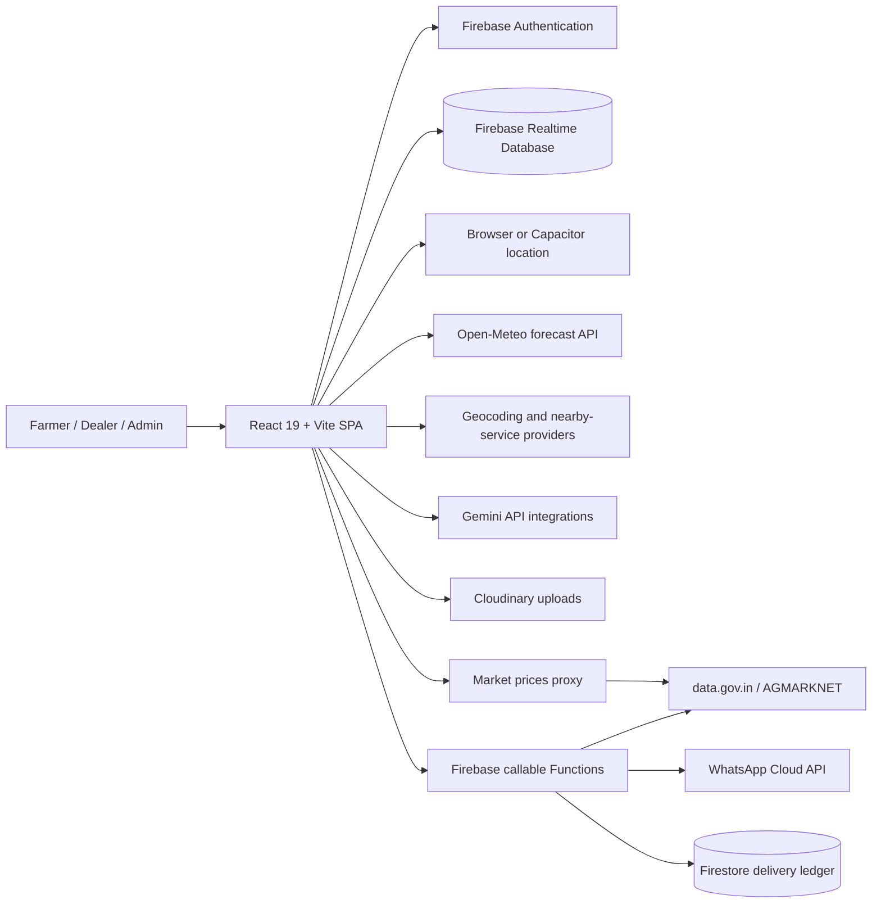
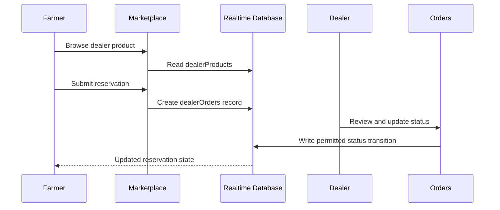
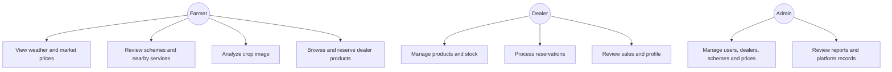

# System Diagrams

## Architecture

## Reservation workflow

## Use cases

Diagrams summarize code-observed integrations. Optional provider configuration and deployment are environment-dependent.
